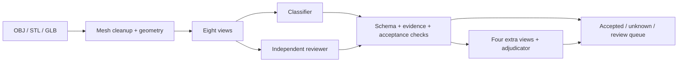

# CAD Function Atlas

**Multimodal functional classification and reproducible evaluation for industrial CAD meshes.**

[简体中文](README.zh-CN.md) · [Experimental report](docs/EXPERIMENT_REPORT.md) · [Dataset](https://huggingface.co/datasets/GeorgeWJJ/cad-function-atlas) · [Releases](https://github.com/13536309143/llm/releases)

Turn OBJ, STL and GLB meshes into broad functional categories, visual evidence and a human-review queue. Geometry processing and multi-view rendering run locally; image understanding uses a configurable vision API. No local large neural model is required.

**Research release:** v0.1.0 was intentionally stopped and frozen. It is not a completed full-corpus evaluation or a production-validated sorter. Directory-reference agreement is **not human-verified accuracy**.


## Capabilities

- Preserve scene transforms, clean invalid/duplicate faces and measure geometry without inventing physical units.
- Render eight views and four additional views for disputed cases using PyVista/VTK.
- Run independent classifier/reviewer calls, validate structured evidence and adjudicate disagreements.
- Predict nine broad function families plus `unknown`, with open-language explanations rather than concrete part names.
- Persist SQLite task state, response audits and input hashes; export CSV/JSON, galleries and review queues.
- Evaluate ablations, repeated inputs, geometric/appearance perturbations and STL/GLB round-trips.
- Use MiniMax, OpenAI Responses/Chat Completions, compatible chat APIs, Claude or Gemini.



Measured agents share one MiniMax backend. Separate roles do not establish independent expertise or correctness. Disputed adjudications remain subject to review.

## Frozen v0.1.0 results

| Measure | Result |
|---|---:|
| Dataset | **7,715 models / 32 source directories** |
| Successful outputs | 7,360 — 95.40% of the dataset |
| Execution failures | 355 |
| Additional experiments | 820 terminal jobs: 817 outputs + 3 expected invalid-input rejections |
| Successful-output reference agreement | 3,581 / 7,161 = **50.01%** |
| Agreement including execution failures | 3,581 / 7,516 = **47.65%** |
| Single → multi-agent, same subset | 49.34% → 50.01% (**+0.67 pp**) |
| Auto-accepted outputs | 752 — 10.22% of successful outputs |
| Accepted-subset reference agreement | 700 / 744 = **94.09%** |
| Identical-input three-run unanimity | 12 / 31 = **38.71%** |

The accepted subset is selected and contains 44 reference disagreements. No human functional gold labels are available. The dataset contains **7,715 models, including execution failures**. See the [analysis](docs/EXPERIMENT_REPORT.md), [metrics JSON](docs/metrics.json) and [source CSV](docs/source_metrics.csv).

## Install and verify

Python 3.11+ is the intended runtime, subject to VTK wheel availability. Locally verified: **Windows 11 / Python 3.14.7**. CI is configured for Windows/Linux with Python 3.12; see actual [workflow runs](https://github.com/13536309143/llm/actions) for remote status.

```powershell
git clone https://github.com/13536309143/llm.git
cd llm
py -3.14 -m venv .venv
.\.venv\Scripts\python.exe -m pip install -r requirements.txt
.\.venv\Scripts\python.exe -m pytest -q
.\.venv\Scripts\python.exe cad_doctor.py --render
```

Linux/macOS: use `python3 -m venv .venv` and `.venv/bin/python`. Headless Linux needs a working EGL/OpenGL backend; see [deployment](docs/DEPLOYMENT.md). Diagnostics make no API calls unless explicitly passed `--live`.

## Configure a vision API

Create `.env` from an example only if it does not already exist. Never commit credentials.

```dotenv
LLM_PROVIDER=minimax
MINIMAX_API_KEY=replace_with_your_key
MINIMAX_API_HOST=https://api.minimaxi.com
```

```dotenv
LLM_PROVIDER=openai_responses
LLM_MODEL=replace_with_your_available_vision_model_id
OPENAI_API_KEY=replace_with_your_key
LLM_MAX_OUTPUT_TOKENS=2048
```

Other adapters: `openai_chat`, `openai_compatible`, `anthropic`, `gemini`. Compatible endpoints use `LLM_BASE_URL` and `LLM_API_KEY`. Choose an image-capable model. See [provider examples and validation status](docs/PROVIDERS.md) and [.env.providers.example](.env.providers.example).

Only MiniMax has historical live benchmark evidence. Other adapters have offline wire-format tests, not measured classification results or guaranteed account access.

## Small test

Put meshes under `data/<source-directory>/`. Source names support sampling and post-inference weak-reference evaluation; they are not inference hints. Use a new output directory each time.

```powershell
# Geometry and rendering only: no API calls
.\.venv\Scripts\python.exe run_function_pilot.py --data data --sources gear bearing washer --per-source 1 --offline --out outputs/smoke

# One image-only capability probe, then bounded multi-agent inference
.\.venv\Scripts\python.exe run_function_pilot.py --data data --sources gear bearing washer --per-source 1 --max-calls 10 --out outputs/pilot_new
```

The probe reads a random code present only in an image. It prevents text connectivity from being mistaken for functioning vision.

## Batch experiments

```powershell
.\.venv\Scripts\python.exe cad_benchmark.py init --data data --root outputs/benchmark_new --max-calls 65000
.\.venv\Scripts\python.exe cad_benchmark.py prepare --root outputs/benchmark_new --workers 3
.\.venv\Scripts\python.exe cad_benchmark.py run --root outputs/benchmark_new --api-workers 3
.\.venv\Scripts\python.exe cad_benchmark.py status --root outputs/benchmark_new
.\.venv\Scripts\python.exe cad_benchmark.py report --root outputs/benchmark_new
.\.venv\Scripts\python.exe benchmark_postprocess.py --root outputs/benchmark_new
```

`run` can launch rendering automatically. Request attempts are bounded and persisted. MiniMax waits for both interval and weekly quota recovery; other adapters never query its quota endpoint. Provider/model/base-URL identity is frozen per new run. Use a new root for comparisons.

**The published `full_benchmark_v1` is frozen.** Create a new experiment root for inference on the 7,715-model dataset; preserve the published measurements for comparison.

Stop a Windows benchmark and its supervisor:

```powershell
powershell -NoProfile -ExecutionPolicy Bypass -File .\Stop-FullBenchmark.ps1 -Root .\outputs\benchmark_new
```

Linux can run the foreground coordinator and stop with Ctrl+C. See [deployment](docs/DEPLOYMENT.md) for supervision, Docker and platform limitations.

## Data, documentation and license

[Hugging Face](https://huggingface.co/datasets/GeorgeWJJ/cad-function-atlas) hosts attempted meshes, render shards, portable SQLite, JSONL, audits, execution source snapshots and cleanup provenance. GitHub holds code, compact metrics and documentation; large CAD assets stay out of Git history.

- [Dataset schema/download](docs/DATASET.md)
- [Reproducibility](docs/REPRODUCIBILITY.md)
- [Original experiment plan](BENCHMARK_TEST_PLAN.md)
- [Changelog](CHANGELOG.md)

Code and documentation: [MIT](LICENSE). This does not relicense CAD meshes or derived third-party assets. Original mesh provenance/licensing was not captured by the initial inventory; the dataset card records this limitation. No neural-model weights are distributed.
