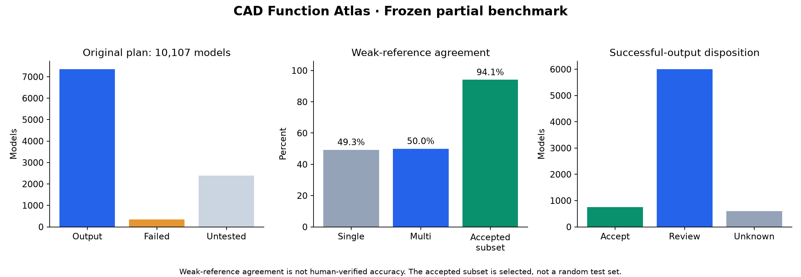

# CAD Function Atlas

**工业 CAD 零部件功能分类与可复现评测。**

[English](README.md) · [完整实验报告](docs/EXPERIMENT_REPORT.zh-CN.md) · [数据集](https://huggingface.co/datasets/GeorgeWJJ/cad-function-atlas) · [Releases](https://github.com/13536309143/llm/releases)

从 OBJ、STL、GLB 网格中推断零部件的宽泛功能类型，输出功能描述、视角证据和人工复核队列。几何处理与多视角渲染在本地完成，图像理解调用可配置的视觉 API，无需本地部署大型神经网络。

**当前为研究版本。** v0.1.0 原全量计划已主动停止并封存，未完成全部输入。目录参考匹配率**不等于人工验证准确率**，目前不支持无复核地自动重排生产模型库。



## 核心能力

- 保留场景变换，清理无效和重复面，提取尺寸比例、面积、有效体积和拓扑。
- 用 PyVista/VTK 生成八视图，对争议样本增加四个观察视角。
- 分类者、独立复核者、裁决者组成结构化验证流程，保留未知与待复核结果。
- 输出九个功能大类加 unknown，以及开放自然语言功能描述，不要求具体零件名。
- 用 SQLite 保存任务与请求，输出 CSV/JSON、图库、输入 SHA 和请求审计。
- 支持消融、重复调用、旋转、尺度/平移、颜色/背景、视图顺序、分辨率和格式转换实验。
- 可配置 MiniMax、OpenAI Responses、Chat Completions、兼容接口、Claude 与 Gemini。

真实实验中的多个 Agent 使用同一 MiniMax 后端。独立请求能检查一致性，但不能证明判断相互独立或已经正确。

## 冻结实验结果

| 指标 | v0.1.0 结果 |
|---|---:|
| 原始计划 | 32 个目录、10,107 个模型 |
| 成功输出 | 7,360 件，覆盖原计划 72.82% |
| 执行失败 | 355 件 |
| 从未尝试，随后清理 | 2,392 件 |
| 附加实验 | 820 项结束：817 项输出、3 项预期输入拒绝 |
| 成功样本参考匹配率 | 3,581 / 7,161 = **50.01%** |
| 包含执行失败的参考匹配率 | 3,581 / 7,516 = **47.65%** |
| 同批单→多 Agent | 49.34% → 50.01%，提升 **0.67 个百分点** |
| 自动接受 | 752 件，占成功输出 10.22% |
| 自动接受子集参考匹配率 | 700 / 744 = **94.09%** |
| 同输入三次完全一致 | 12 / 31 = **38.71%** |

自动接受子集仍有 44 件与参考冲突，没有人工功能真值，不能作为真实精度保证。发布保留**全部 7,715 件已尝试模型，包括失败样本**，明确记录清理范围。详见 [完整分析](docs/EXPERIMENT_REPORT.zh-CN.md)、[统计 JSON](docs/metrics.json) 和 [来源分层表](docs/source_metrics.csv)。

## 环境安装与检查

目标为具有兼容 VTK wheel 的 Python 3.11+。本机已验证 **Windows 11 / Python 3.14.7**。CI 配置为 Windows/Linux、Python 3.12；实际远端状态请查看 [Actions](https://github.com/13536309143/llm/actions)。

```powershell
git clone https://github.com/13536309143/llm.git
cd llm
py -3.14 -m venv .venv
.\.venv\Scripts\python.exe -m pip install -r requirements.txt
.\.venv\Scripts\python.exe -m pytest -q
.\.venv\Scripts\python.exe cad_doctor.py --render
```

Linux/macOS 使用 `python3 -m venv .venv`，Python 路径改为 `.venv/bin/python`。无桌面 Linux 需要可用的 EGL/OpenGL 后端，见 [部署文档](docs/DEPLOYMENT.md)。`cad_doctor.py --render` 只检查本地依赖、几何和渲染；仅显式传入 `--live` 才会消费一次视觉 API 请求。

## 配置 API

不存在 `.env` 时再从示例创建，已有配置不要覆盖。密钥不进入 Git 或发布包。

```dotenv
LLM_PROVIDER=minimax
MINIMAX_API_KEY=replace_with_your_key
MINIMAX_API_HOST=https://api.minimaxi.com
```

OpenAI 视觉 API 示例：

```dotenv
LLM_PROVIDER=openai_responses
LLM_MODEL=replace_with_your_available_vision_model_id
OPENAI_API_KEY=replace_with_your_key
LLM_MAX_OUTPUT_TOKENS=2048
```

其他适配器为 `openai_chat`、`openai_compatible`、`anthropic`、`gemini`；兼容服务设置 `LLM_BASE_URL` 和 `LLM_API_KEY`。必须选择支持图片输入的模型。完整示例和验证状态见 [PROVIDERS](docs/PROVIDERS.md) 和 [.env.providers.example](.env.providers.example)。

只有 MiniMax 有真实基准证据；新增适配器通过模拟 HTTP 的协议测试，未测得其他服务的真实分类效果。

## 小规模测试

把模型放在 `data/<来源目录>/`。目录用于抽样和推理后弱参考评估，不作为模型输入提示。每次使用新输出目录。

```powershell
# 离线几何和渲染，不调用 API
.\.venv\Scripts\python.exe run_function_pilot.py --data data --sources gear bearing washer --per-source 1 --offline --out outputs/smoke

# 真实视觉探针及分类，需要额度
.\.venv\Scripts\python.exe run_function_pilot.py --data data --sources gear bearing washer --per-source 1 --max-calls 10 --out outputs/pilot_new
```

真实调用先识别只存在于图片中的随机代码，防止把文本连接成功误认为视觉可用。分数是主观值，不是校准概率。

## 批量实验、断点与报告

```powershell
.\.venv\Scripts\python.exe cad_benchmark.py init --data data --root outputs/benchmark_new --max-calls 65000
.\.venv\Scripts\python.exe cad_benchmark.py prepare --root outputs/benchmark_new --workers 3
.\.venv\Scripts\python.exe cad_benchmark.py run --root outputs/benchmark_new --api-workers 3
.\.venv\Scripts\python.exe cad_benchmark.py status --root outputs/benchmark_new
.\.venv\Scripts\python.exe cad_benchmark.py report --root outputs/benchmark_new
.\.venv\Scripts\python.exe benchmark_postprocess.py --root outputs/benchmark_new
```

`run` 也可自动启动渲染。请求次数有上限且持久化；MiniMax 窗口或周额度不足时等待，恢复后续跑。其他服务不查询 MiniMax 额度接口。新实验冻结 provider/model/base URL，切换服务或模型需使用新根目录。

**已发布 `full_benchmark_v1` 不允许继续推理**：未尝试输入已主动清理，历史计划行保留用于计算完成率。对保留数据重新实验属于新的子集测试，不能称为原全库续跑。

Windows 停止指定测试及其监督进程：

```powershell
powershell -NoProfile -ExecutionPolicy Bypass -File .\Stop-FullBenchmark.ps1 -Root .\outputs\benchmark_new
```

Linux 可前台运行并用 Ctrl+C 停止。部署、Docker、环境测试、监督进程及平台边界见 [DEPLOYMENT](docs/DEPLOYMENT.md)。

## 数据、文档与许可

大体积网格、渲染分片、便携 SQLite、JSONL、审计、历史执行源码和清理凭据保存在 [Hugging Face](https://huggingface.co/datasets/GeorgeWJJ/cad-function-atlas)，不进入 Git 历史。

- [完整实验报告](docs/EXPERIMENT_REPORT.zh-CN.md)：全部对照、指标分母、误差和限制。
- [数据结构与下载](docs/DATASET.md)：数据表、分片、校验及解压。
- [复现说明](docs/REPRODUCIBILITY.md)：原实现、当前代码、环境和数据范围。
- [原始实验计划](BENCHMARK_TEST_PLAN.md) 与 [版本变更](CHANGELOG.md)。

源代码与文档采用 [MIT](LICENSE)。该许可不重新授权 CAD 网格或第三方衍生内容；初始清单未记录网格来源许可，数据卡明确保留这一限制。本项目不发布模型权重。
