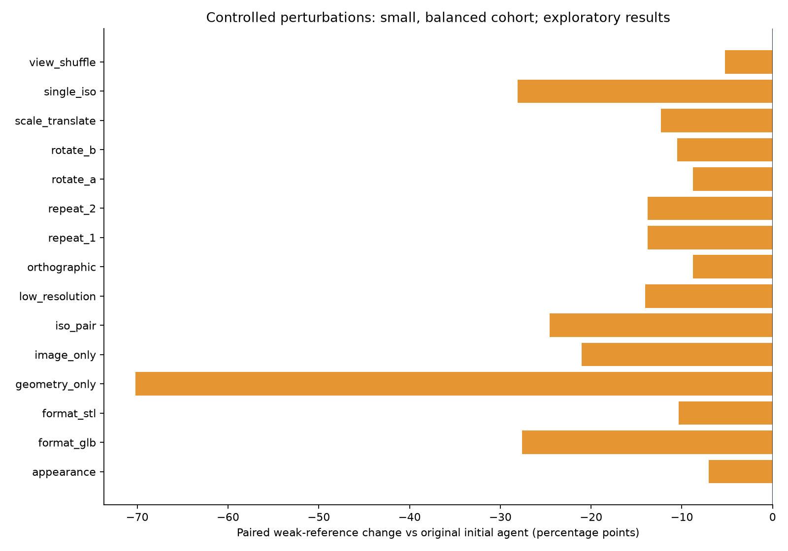
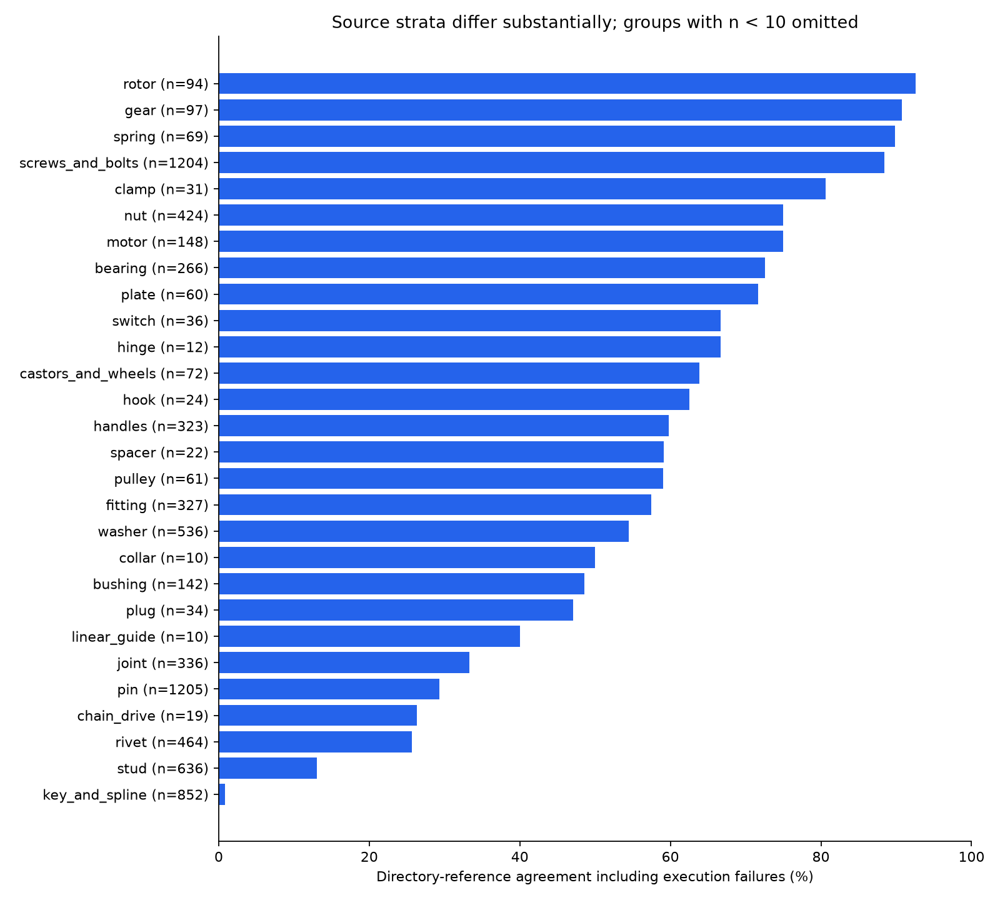

# CAD Function Atlas — 实验报告 v0.1.0

[English report](EXPERIMENT_REPORT.md) · [统计 JSON](metrics.json) · [原实验计划](../BENCHMARK_TEST_PLAN.md)

**本报告分析包含 7,715 个模型的冻结评测数据集。** 报告生成时间：2026-10-18T19:03:16+08:00。真实推理发生于 2026 年 10 月 16—18 日（北京时间）；本次文档修订未新增推理。

## 主要结论

数据集包含 **7,715 个工业 CAD 模型**：7,360 个得到结构化功能结果，355 个执行失败。成功输出的弱参考匹配率为 **50.01%**；将执行失败计入后为 **47.65%**。同批成功可评估样本中，多 Agent 将匹配率从 49.34% 提高到 50.01%，净增 **0.67 个百分点**，尚不能证明真实功能准确率获得有实用价值的改善。

自动接受 752 件，占成功输出 10.22%；其中 744 件有可用目录参考，700 件匹配、44 件不匹配，参考匹配率 **94.09%**。另 8 件无可用参考。这个数字描述经过筛选的子集，不能作为经过人工验证的精度保证。6,008 件需要复核，600 件保留未知。

同输入三次独立调用只有 12/31 组完全一致（38.71%），平均两两一致率 52.69%。小规模重复试验已暴露明显输出波动，方向、视图顺序、分辨率和转换格式也会改变结果。因此当前成果适合研究、候选分类与人工复核，不适合无复核地移动整个工业模型库。

## 任务定义与方法

输入来自 32 个现有零件目录，输出为九个宽泛功能族加 unknown，以及开放自然语言功能描述和视角证据。目录中的具体零件名不是最终任务标签。功能代码是固定上位体系，不能把自由文本解释等同于无限类别识别。

Trimesh 保留场景变换，清理无效与重复面，中心化和尺度归一化；尺寸保留未知源单位，不编造毫米。PyVista/VTK 生成八视图。分类者与复核者分别请求同一服务，互不查看对方结论；校验器检查 JSON、证据引用、主观分数、上下文需求和几何质量。存在争议时增加四视图并调用裁决者；裁决后的争议结果仍待复核或未知，不因多数意见强行接受。

所有真实实验均使用 MiniMax Token Plan VLM，接口没有暴露底层模型版本。三个角色是同一后端上的独立调用，不是三个独立模型，可能产生相关错误。新增的 OpenAI Responses、Chat Completions、兼容接口、Claude、Gemini 支持只完成协议模拟测试，**没有声称测得这些服务的真实效果**。

本次评测包括 7,715 个模型的主测试，以及 820 项附加实验。62 件平衡队列覆盖十一项消融与扰动；32 件队列分别进行两轮重复和 STL/GLB 格式转换；10 件合成探针包含 3 个无效几何。附加实验全部结束：817 项得到输出，3 项按预期被预处理拒绝。因一个主测试没有有效初判，配对数量为 61 或 31；再去掉无可靠参考目录，参考配对为 57 或 29。具体分母见表，不把不同样本直接横向当作精度提升。

## 指标口径

参考来自目录到功能集合的冻结映射，属于弱参考。已知预测属于允许的参考集合时记为匹配；ring、disc 等仅表示通用外形的目录不强制赋予功能参考，不参与匹配率。目录、文件名与参考映射不传入模型提示词。

包含执行失败的指标把 unknown 和错误任务记为不匹配；数据集范围以 7,715 个模型清单为准，范围外的历史计划行不参与指标计算。成功样本单/多 Agent 比较使用同一批 7,161 个有参考输出。来源宏平均是 30 个有参考原目录的平均，不是九类人工功能真值的宏平均。原目录严重不均衡，各目录完成比例不同，停止与缺失并非随机，不能外推剩余样本性能。置信分数未经校准。没有人工真值、独立留出功能测试集、真实域外拒识基准，也没有可验证的 token 总量或货币成本。

## 误差与有效性分析

1. **多 Agent 收益有限。** 冻结统计显示 431 次参考增益、383 次参考损失，净增 48 件。共同后端可能强化相同视觉误解，角色独立并不意味着判断独立或已经验证正确。
2. **自动接受覆盖低。** 94.09% 只适用于约十分之一输出；仍有 44 个高置信接受结果与参考冲突，需要人工检查参考和模型双方，不能直接称为 44 个已确认错误。
3. **输入依赖明显。** 图像、几何、视角之间存在互补。仅几何的空白图试验反映此视觉端点及提示设置的表现，不是专门几何分类器的性能基线。
4. **转换有混杂因素。** STL/GLB 重新导出会扁平化清理后的场景，并可能改变数值精度或拓扑；格式一致性结果衡量转换—渲染—推理整条链，不能断言扩展名本身导致错误。颜色/背景试验还改变文字对比度，不能只归因于表面颜色。
5. **接口可靠性需单独改进。** 355 个失败中，226 个空响应、111 个网络异常、18 个达到格式/尝试上限。执行失败与功能误判分开；停止后没有补跑以筛选更有利的结果。
6. **弱参考与抽样限制。** 来源类别之间差异很大；难区分的通用形状需要装配关系和用途信息。补充报告中的来源簇 bootstrap 只是探索性区间，不能把弱标签变成真实准确率或因果结论。

## 数据集与复现

数据集包含 **7,715 个工业 CAD 模型**，包括全部 355 个执行失败样本。已核对所有发布模型的 SHA-256；网格、渲染图与请求证据通过样本清单关联。SQLite 同时保留带有数据集成员标识的历史计划元数据；这些附加记录不计入数据集模型数量。

当前发布已封存；新模型/供应商实验应创建新输出目录。数据包包含网格、渲染图、SQLite、JSONL、清单、请求审计和原执行源码快照，足以追溯输入和历史请求。当前新增适配器及修复不能被当作每条历史请求实际执行的版本。部署检查见 [DEPLOYMENT](DEPLOYMENT.md)，接口配置见 [PROVIDERS](PROVIDERS.md)，数据结构见 [DATASET](DATASET.md)。

本机已实测 Windows 11 / Python 3.14.7 的依赖、几何与离屏渲染。供应商协议测试使用模拟 HTTP，不消费新 API 额度。CI 配置包含 Windows/Linux；配置存在不等于远端工作流已成功。

## 下一步建议

建立带装配语境、双人复核和独立留出集的功能真值；明确连接、定位、支承等重叠边界；固定输入比较不同真实视觉服务；重复运行并统计每个正确接受样本的成本；分别验证分数校准、未知判断和网络恢复。当前结论不支持无人复核的生产库重排。

## Frozen measurements / 冻结统计

| Measure / 指标 | Value / 数值 |
| --- | --- |
| Dataset models / 数据集模型数 | 7715 |
| Successful outputs / 成功输出 | 7360 |
| Execution failures / 执行失败 | 355 |
| Output coverage / 输出覆盖率 | 95.40% |
| Successful-only reference agreement / 成功样本参考匹配 | 3581/7161 = 50.01% |
| Reference agreement including failures / 包含执行失败 | 3581/7516 = 47.65% |
| Source macro reference agreement / 来源宏平均 | 56.67% |
| Single → multi, paired / 同批单→多 Agent | 49.34% → 50.01% |
| Accepted / review / unknown | 752 / 6008 / 600 |
| Accepted-subset reference agreement / 自动接受子集 | 700/744 = 94.09% |
| Accepted coverage among outputs / 自动接受覆盖 | 10.22% |
| Recorded API attempts / API 尝试次数 | 23232 |
| Human-verified accuracy / 人工准确率 | Not available / 未测得 |

## Controlled experiments / 配对对照

| Experiment | Paired n | Reference n | Initial reference | Variant reference | Class agreement |
| --- | --- | --- | --- | --- | --- |
| appearance | 61 | 57 | 70.18% | 63.16% | 60.66% |
| format_glb | 31 | 29 | 68.97% | 41.38% | 32.26% |
| format_stl | 31 | 29 | 68.97% | 58.62% | 45.16% |
| geometry_only | 61 | 57 | 70.18% | 0.00% | 1.64% |
| image_only | 61 | 57 | 70.18% | 49.12% | 47.54% |
| iso_pair | 61 | 57 | 70.18% | 45.61% | 49.18% |
| low_resolution | 61 | 57 | 70.18% | 56.14% | 55.74% |
| orthographic | 61 | 57 | 70.18% | 61.40% | 47.54% |
| repeat_1 | 31 | 29 | 68.97% | 55.17% | 41.94% |
| repeat_2 | 31 | 29 | 68.97% | 55.17% | 54.84% |
| rotate_a | 61 | 57 | 70.18% | 61.40% | 57.38% |
| rotate_b | 61 | 57 | 70.18% | 59.65% | 62.30% |
| scale_translate | 61 | 57 | 70.18% | 57.89% | 52.46% |
| single_iso | 61 | 57 | 70.18% | 42.11% | 36.07% |
| view_shuffle | 61 | 57 | 70.18% | 64.91% | 68.85% |

## Source strata / 来源分层

| Source | Dataset models | Output | Error | Reference n | Agreement incl. errors |
| --- | --- | --- | --- | --- | --- |
| bearing | 266 | 262 | 4 | 266 | 72.56% |
| bushing | 142 | 142 | 0 | 142 | 48.59% |
| castors_and_wheels | 72 | 72 | 0 | 72 | 63.89% |
| chain_drive | 19 | 19 | 0 | 19 | 26.32% |
| clamp | 31 | 31 | 0 | 31 | 80.65% |
| collar | 10 | 10 | 0 | 10 | 50.00% |
| disc | 21 | 21 | 0 | 0 | — |
| fitting | 327 | 315 | 12 | 327 | 57.49% |
| flange | 1 | 1 | 0 | 1 | 0.00% |
| gear | 97 | 96 | 1 | 97 | 90.72% |
| handles | 323 | 311 | 12 | 323 | 59.75% |
| hinge | 12 | 12 | 0 | 12 | 66.67% |
| hook | 24 | 24 | 0 | 24 | 62.50% |
| joint | 336 | 322 | 14 | 336 | 33.33% |
| key_and_spline | 852 | 804 | 48 | 852 | 0.82% |
| linear_guide | 10 | 10 | 0 | 10 | 40.00% |
| motor | 148 | 148 | 0 | 148 | 75.00% |
| nut | 424 | 387 | 37 | 424 | 75.00% |
| pin | 1205 | 1147 | 58 | 1205 | 29.29% |
| plate | 60 | 60 | 0 | 60 | 71.67% |
| plug | 34 | 34 | 0 | 34 | 47.06% |
| pulley | 61 | 61 | 0 | 61 | 59.02% |
| ring | 178 | 178 | 0 | 0 | — |
| rivet | 464 | 415 | 49 | 464 | 25.65% |
| rotor | 94 | 94 | 0 | 94 | 92.55% |
| screws_and_bolts | 1204 | 1167 | 37 | 1204 | 88.46% |
| spacer | 22 | 22 | 0 | 22 | 59.09% |
| spring | 69 | 69 | 0 | 69 | 89.86% |
| stud | 636 | 598 | 38 | 636 | 13.05% |
| switch | 36 | 36 | 0 | 36 | 66.67% |
| valve | 1 | 1 | 0 | 1 | 100.00% |
| washer | 536 | 491 | 45 | 536 | 54.48% |

## Predicted functions / 预测功能分布

| Function code | 中文 | Outputs |
| --- | --- | --- |
| connection_fastening | 连接与紧固 | 2498 |
| support_guidance | 支承与导向 | 1359 |
| positioning_spacing | 定位限位与间隔 | 1359 |
| unknown | 待确认功能 | 600 |
| transmission_drive | 动力与传动 | 405 |
| structural_support | 结构承载与防护 | 300 |
| fluid_control | 流体输送与控制 | 292 |
| operation_control | 操作与控制 | 249 |
| sealing_closure | 密封与封堵 | 221 |
| elastic_buffering | 弹性储能与缓冲 | 77 |

## Execution failures / 执行失败

| Execution error | Models |
| --- | --- |
| MiniMax returned no image understanding content | 226 |
| [SSL: UNEXPECTED_EOF_WHILE_READING] EOF occurred in violation of protocol (_ssl.c:1082) | 93 |
| Per-role attempt/JSON repair limit reached | 18 |
| [WinError 10054] 远程主机强迫关闭了一个现有的连接。 | 10 |
| Server disconnected without sending a response. | 5 |
| The read operation timed out | 1 |
| [WinError 10051] 向一个无法连接的网络尝试了一个套接字操作。 | 1 |
| [Errno 11001] getaddrinfo failed | 1 |

## Geometry subgroups / 几何子组

| Geometry subgroup | Reference n | Reference agreement | Auto-accept coverage |
| --- | --- | --- | --- |
| not_watertight | 2752 | 66.02% | 15.23% |
| volume_unavailable | 2753 | 66.04% | 15.22% |
| triangles_10k_to_100k | 493 | 76.47% | 33.27% |
| watertight | 4409 | 40.01% | 7.37% |
| volume_valid | 4408 | 40.00% | 7.37% |
| triangles_1k_to_10k | 3018 | 64.38% | 14.08% |
| triangles_lt_1k | 3598 | 33.74% | 3.95% |
| triangles_ge_100k | 52 | 90.38% | 25.00% |

## API operations / 接口运行

| API role | Attempts with latency | Median seconds | p95 seconds |
| --- | --- | --- | --- |
| reviewer | 7697 | 7.08 | 10.91 |
| classifier | 8786 | 7.73 | 12.04 |
| probe | 1 | 3.95 | 3.95 |
| adjudicator | 6748 | 7.04 | 9.67 |

23,232 attempts were recorded: 22,849 transport/content completions and 383 request errors. A successful HTTP/content response can still fail schema validation. Quota pauses contribute waiting time beyond active inference. Actual token totals and monetary cost were not exposed and are not estimated from request counts. / 请求成功与任务成功分开计数，等待额度也计入墙钟时间；未从调用次数编造 token 或货币费用。
